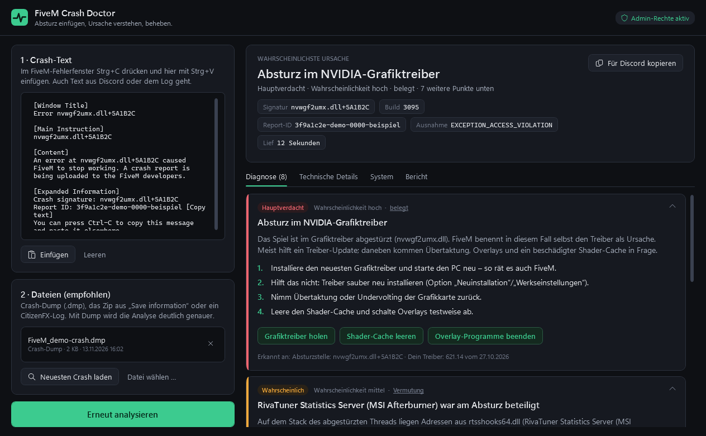

# FiveM Crash Doctor

Wertet FiveM-Abstürze aus und sagt dir, woran es liegt – und behebt typische Ursachen auf Knopfdruck.

Crash-Fenster mit **Strg+C** kopieren, einfügen, den Dump dazulegen, **Analysieren**. Das Tool liest Crash-Signatur, Crash-Namen, Ausnahme, Module und Stack aus dem Minidump, das Client-Log und das Spielprotokoll, prüft deinen PC und zeigt die wahrscheinlichsten Ursachen mit konkreten Schritten.



> Inoffizielles Werkzeug. Nicht mit Cfx.re, Rockstar Games oder Take-Two verbunden. „FiveM“ ist eine Marke ihrer Inhaber.

## Was es kann

**Einlesen**
- Den kopierten Text des Crash-Fensters – englisch und deutsch (Formate aus dem FiveM-Quelltext nachgelesen)
- Crash-Dumps (`.dmp`) aus `FiveM.app\crashes`, ohne Debugger und ohne Symbole
- Das Zip aus „Save information“ (`CfxCrashDump_….zip`) mit Dump, Client-Log und `crashometry.json`
- Client-Logs (`CitizenFX_log_….log`) und das Spielprotokoll `….dmp.gamelog`
- „Neuesten Crash laden“ findet alles selbst – auch wenn FiveM nicht im Standardordner liegt

**Erkennen**
- Bekannte Crash-Namen aus der offiziellen Liste von Cfx.re (z. B. `sweet-sad-july`, `tennis-stairway-seven`)
- Abstürze im Grafiktreiber (NVIDIA, AMD, Intel), in Overlays, Aufnahme-Tools, Audio-Software und Sicherheitssoftware
- Programme, die FiveM selbst blockiert (Nahimic, Bandicam, Discord-Hook, Lenovo/HP-Tools …)
- ReShade, ENB und ASI-Plugins – getrennt nach Pfad: eine `dxgi.dll` aus `System32` ist DirectX, dieselbe Datei aus `plugins` ist ReShade
- FiveMs eigene Schutzfalle („Early-exit trap“ / „Game integrity check failed“) direkt aus dem Dump
- Spielfehler wie `ERR_GFX_D3D_INIT`, `ERR_MEM_…`, DirectX „Device removed“
- Speicherprobleme: fehlende Auslagerungsdatei, voller Streaming-Speicher, erschöpfter Speicher beim Absturz
- Wiederkehrende Abstürze: mehrere Dumps werden verglichen
- Kein Absturz, sondern ein Disconnect? Wird erkannt.

Jede Diagnose sagt, **wie belastbar** sie ist: *belegt* (FiveM-Quelltext oder offizielle Doku), *Erfahrungswert* oder *Vermutung*.

**Beheben** – jede Reparatur zeigt vorher genau, was passiert und wie man es rückgängig macht:

| Reparatur | Was passiert | Admin |
| --- | --- | --- |
| FiveM-Cache leeren | löscht `data\cache`, `server-cache`, `server-cache-priv`; `game-storage` bleibt | – |
| Plugins deaktivieren | benennt den Ordner `plugins` nur um | – |
| Mods aus GTA-Ordner sichern | verschiebt `d3d11.dll`, `dxgi.dll`, `*.asi` … in einen Sicherungsordner | nur wenn nötig |
| Grafikeinstellungen zurücksetzen | benennt `gta5_settings.xml` / `settings.xml` in `.bak` um | – |
| Shader-Cache leeren | leert den DirectX-Cache von NVIDIA, AMD und Windows | – |
| Overlay-Programme beenden | RivaTuner, Afterburner, Bandicam, Overwolf … | – |
| Spieldateien prüfen | startet die Prüfung in Steam bzw. zeigt den Weg für Epic/Rockstar | – |
| Auslagerungsdatei automatisch | stellt die Windows-Einstellung um (Neustart nötig) | ja |
| Windows-Dateien reparieren | `DISM /RestoreHealth` und `sfc /scannow` im Konsolenfenster | ja |
| Release-Kanal einstellen | setzt `UpdateChannel` in `CitizenFX.ini` zurück auf `production` | – |
| Treiber, VC++ Runtime, Cfx-Testserver | öffnet die offiziellen Seiten | – |
| Support-Paket erstellen | ZIP mit Bericht, Dump und Log für Server-Team oder Cfx-Forum | – |

**Admin-Rechte:** Das Tool startet normal. Nur Reparaturen, die sie wirklich brauchen, fragen per UAC nach – und der erhöhte Prozess führt dann genau diese eine Reparatur aus. Wer will, kann oben rechts das ganze Tool als Admin neu starten.

**Updates:** Das Tool prüft beim Start und stündlich, ob es eine neue Version gibt, und zeigt dann oben ein Banner: *Jetzt aktualisieren*, *Später* oder *Überspringen*. Ein Klick lädt die neue EXE, prüft sie und startet sie neu. Wer will, lässt Updates beim Start automatisch installieren (Version oben rechts anklicken). Installiert wird nur eine Datei, deren SHA-256-Prüfsumme stimmt **und** die mit dem Zertifikat des Projekts signiert ist – sonst wird der Download verworfen.

**Teilen:** „Für Discord kopieren“ erzeugt eine Kurzfassung unter 2000 Zeichen, „Bericht kopieren“ den vollen Bericht als Markdown. Dein Windows-Benutzername wird dabei entfernt.

## Installation

1. Unter [Releases](../../releases) die neueste `FiveMCrashDoctor.exe` herunterladen.
2. Starten. Fertig – keine Installation, keine Zusatzpakete (.NET Framework 4.8 ist in Windows 10 und 11 enthalten).

Windows SmartScreen kann beim ersten Start warnen, weil die Datei nicht kommerziell signiert ist: „Weitere Informationen“ → „Trotzdem ausführen“. Die Prüfsumme steht neben jeder EXE als `.sha256`:

```powershell
Get-FileHash .\FiveMCrashDoctor.exe -Algorithm SHA256
```

## So benutzt du es

1. FiveM stürzt ab → im Fehlerfenster einmal hineinklicken und **Strg+C** drücken.
2. Im Tool **Einfügen** (oder Strg+V) und **Neuesten Crash laden**.
3. **Analysieren** (oder Strg+Enter).
4. Oben steht die wahrscheinlichste Ursache, darunter die Schritte und Reparatur-Knöpfe.

Ohne Eingabe prüft „Analysieren“ nur deinen PC (RAM, Auslagerungsdatei, Treiber, Plugins, Overlays).

Ohne Fenster, z. B. für Skripte:

```powershell
FiveMCrashDoctor.exe --report bericht.md --latest
FiveMCrashDoctor.exe --report bericht.md --text crash.txt C:\Pfad\zum\dump.dmp
FiveMCrashDoctor.exe --update
```

## Datenschutz

Alles läuft lokal. Das Tool lädt nichts hoch und hat keine Telemetrie. Ins Netz geht es nur für die Update-Prüfung (eine Anfrage an `api.github.com` ohne Daten von dir, abschaltbar über die Versionsnummer oben rechts) und wenn du einen der Link-Knöpfe drückst. Spieler-Kennungen aus `crashometry.json` (z. B. die Rockstar-ID) werden verworfen. Ein eigenes Protokoll liegt unter `%LOCALAPPDATA%\FiveMCrashDoctor\logs`.

Dumps und Logs, die du teilst, können Server- und Spielernamen und Teile des Spielspeichers enthalten – teile sie nur mit Leuten, denen du vertraust.

## Bauen

Voraussetzung: .NET SDK 8 oder neuer (die App zielt auf .NET Framework 4.8, das SDK holt die Referenz-Assemblys selbst).

```powershell
dotnet test tests/CrashDoctor.Tests/CrashDoctor.Tests.csproj
dotnet build src/CrashDoctor/CrashDoctor.csproj -c Release
```

Die EXE liegt danach unter `src/CrashDoctor/bin/Release/net48/FiveMCrashDoctor.exe`. Hinweis: Liegt das Repo in einem sehr tief verschachtelten Ordner, scheitert .NET Framework an der 260-Zeichen-Pfadgrenze – dann in einen kürzeren Pfad klonen.

### Aufbau

| Ordner | Inhalt |
| --- | --- |
| `src/CrashDoctor/Core` | Parser (Crash-Text, Minidump, Logs, Spielprotokoll), Wissensbasis, Regeln, Bericht. Kein WPF, kein WMI, keine Prozesse – vollständig testbar. |
| `src/CrashDoctor/Platform` | Windows-Schicht: FiveM finden, PC messen, Reparaturen, Admin-Hilfsprozess |
| `src/CrashDoctor/UI`, `MainWindow.xaml` | Oberfläche (WPF) |
| `tests/CrashDoctor.Tests` | xUnit-Tests mit nachgebauten Minidumps und einer Schein-FiveM-Installation |

### Release veröffentlichen

1. `<Version>` in `src/CrashDoctor/CrashDoctor.csproj` hochziehen, committen, pushen, CI grün abwarten.
2. Release-Text in eine Datei schreiben (erste Zeile = Titel), dann `git tag -a vX.Y.Z -F notes.txt` und `git push origin vX.Y.Z`.
3. Der Workflow prüft Tag gegen Version, testet, baut, **signiert** (Secrets `CODESIGN_PFX_BASE64`, `CODESIGN_PFX_PASSWORD`), prüft die Signatur gegen den Pin in `Platform/Updater.cs`, macht einen Probelauf und veröffentlicht erst, wenn EXE und Prüfsumme im Entwurf liegen.

Ein kaputtes Release zurückrufen: `gh release edit vX.Y.Z --prerelease` – dann bietet der Updater wieder die Vorgängerversion an (Dateien nicht löschen). Zertifikatswechsel: den neuen Thumbprint **zusätzlich** in `TrustedThumbprints` eintragen, im selben Release, das erstmals damit signiert ist.

Updates erreichen andere Leute nur, wenn das Repo öffentlich ist – Releases privater Repos sieht GitHub nur angemeldeten Personen mit Zugriff.

### Wissensbasis erweitern

Die Regeln stehen in `src/CrashDoctor/Core/Knowledge.cs` (Module, Prozesse, Ausnahmecodes, bekannte Crash-Namen) und `Analyzer.cs` (Diagnosen). Neue Einträge bitte mit Belegklasse: *Belegt* nur mit Quelle (FiveM-Quelltext, docs.fivem.net, Cfx-Mitarbeiter), sonst *Praxis* oder *Vermutung*. Ein Test für den neuen Fall gehört dazu.

## Quellen

- citizenfx/fivem: `code/client/launcher/MiniDump.cpp` (Crash-Dialog, Signatur, Schutzfalle), `data/client/citizen/crash-data.json` (bekannte Crash-Namen), `code/client/citicore/FileMapping.Win32.cpp` (von FiveM blockierte DLLs), `code/components/rage-graphics-five/src/RenderHooks.cpp` (DirectX-Fehler, Grafik-Mods), `data/client/citizen/locales/de/…/cfx.po` (deutsche Texte)
- docs.fivem.net: Client issues (Cfx-Testserver), Enabling Full Client Dumps
- Minidump-Format: `minidumpapiset.h` (Windows SDK)

## Lizenz

MIT – siehe [LICENSE](LICENSE).
